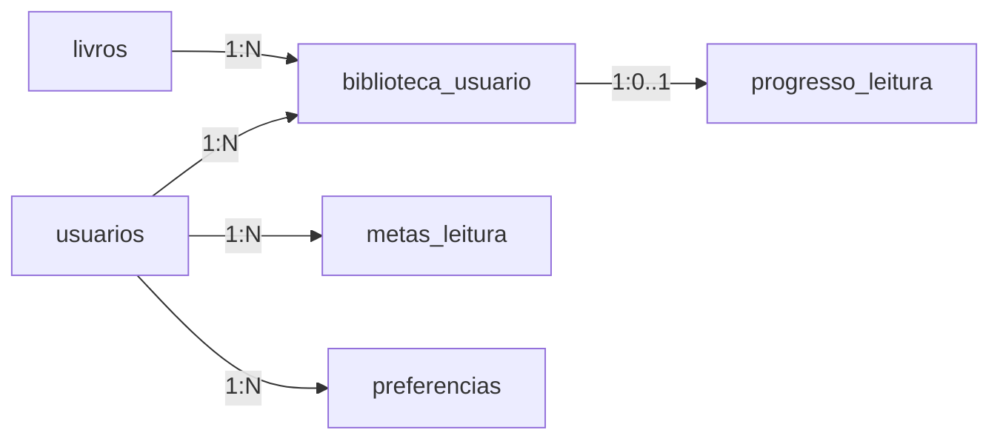

# Modelagem PostgreSQL

## Decisões

### Identidade e contas

`usuarios.id` usa UUID gerado pelo servidor. `nome_usuario` é normalizado na aplicação e também precisa estar canônico no banco; um índice único impede colisões. `senha_hash` recebe somente hash Werkzeug, não senha em texto puro. As rotas Flask de cadastro e login usam esta tabela e conferem o hash antes de iniciar uma sessão.

### Livros, obras e edições

Cada linha de `livros` representa o registro bibliográfico escolhido e mantém seu escopo de obra ou edição em `metadados.metadata_scope`; título sozinho não une registros. Um candidato Open Library pode continuar em nível de obra. O campo ISBN canônico fica nulo quando o ISBN recebido é agregado à obra; quando preenchido com identidade de edição confirmada, a camada Python grava forma compacta e o banco protege unicidade ignorando pontuação. `origem_catalogo` com `identificador_externo` forma a outra chave natural parcial. Títulos repetidos são permitidos.

Autores, gêneros e assuntos são listas JSONB de textos. Essa representação preserva os metadados heterogêneos da Open Library sem expandir a modelagem para tabelas auxiliares ainda sem operações de consulta próprias. As restrições no PostgreSQL exigem que esses campos sejam arrays; o repositório verifica elementos textuais.

A coluna `livros.metadados` é JSONB e conserva campos complementares opcionais e sua proveniência. A revisão `9a7d31f2c4e8` acrescentou a coluna sem alteração retroativa dos registros; o objeto inclui escopo `work` ou `work_and_edition` quando informado.

### Coleção e progresso

`biblioteca_usuario` é a associação N:N entre usuários e livros. A restrição única no par impede cópias da mesma edição dentro da biblioteca de uma conta sem impedir que outras contas usem o mesmo livro. Não há coluna duplicada de status nessa tabela. `progresso_leitura.status` mantém o estado; suas páginas e datas têm restrições de integridade. A relação 1:0..1 permite manter livros ainda sem progresso detalhado.

### Metas e preferências

`metas_leitura` representa quantidade pretendida em intervalo de datas e não armazena progresso derivado. `preferencias` mantém apenas categoria, texto, normalização e intensidade, sem introduzir mecanismo de recomendação novo.

### Exclusões e timestamps

As referências usam `ON DELETE RESTRICT`. A remoção de item pessoal é explícita e condicionada ao proprietário; o progresso vinculado é removido antes da associação. Livros compartilhados não são apagados junto com uma biblioteca. Timestamps de eventos usam `TIMESTAMPTZ`; datas de metas não dependem de horário.

## Campos

| Tabela | Campo | Tipo PostgreSQL | Regra principal |
|---|---|---|---|
| usuarios | id | UUID | PK com `gen_random_uuid()` |
| usuarios | nome | VARCHAR(160) | Obrigatório e não vazio |
| usuarios | nome_usuario | VARCHAR(80) | Obrigatório, canônico e único |
| usuarios | senha_hash | VARCHAR(255) | Obrigatório, nunca texto puro |
| livros | id | UUID | PK |
| livros | titulo | VARCHAR(500) | Obrigatório e não vazio |
| livros | autores, generos, assuntos | JSONB | Arrays de textos; autores/coleções vazias são permitidos |
| livros | metadados | JSONB | Objeto complementar e proveniência; padrão `{}` |
| livros | isbn | VARCHAR(32) | Opcional; forma compacta validada e única |
| livros | origem_catalogo, identificador_externo | VARCHAR | O par é opcional e único quando preenchido |
| livros | ano_publicacao | INTEGER | Opcional, entre 0 e 9999 |
| biblioteca_usuario | usuario_id, livro_id | UUID | FKs `RESTRICT`, par único |
| progresso_leitura | biblioteca_usuario_id | UUID | FK única para associação pessoal |
| progresso_leitura | status | VARCHAR(20) | Quatro valores enumerados por CHECK |
| progresso_leitura | paginas_lidas, total_paginas | INTEGER | Não negativos, total positivo e limite validado |
| metas_leitura | quantidade_objetivo | INTEGER | Positiva |
| metas_leitura | periodo_inicio, periodo_fim | DATE | Fim posterior ao início; par único por dono |
| preferencias | categoria | VARCHAR(12) | `genero` ou `assunto` |
| preferencias | valor, valor_normalizado | VARCHAR(160) | Obrigatório; chave única por usuário/categoria |
| preferencias | nivel | INTEGER | De 1 a 5 |

Cada tabela inclui `criado_em` e `atualizado_em` com timezone, com exceção da associação, que possui `adicionado_em` como instante próprio de inclusão além dos campos de auditoria.

## Relacionamentos e índices

O índice único de `usuarios.nome_usuario` atende busca por usuário. Em livros, índices parciais cobrem origem/ID externo e ISBN normalizado. `biblioteca_usuario` tem chave única por usuário/livro e índice por usuário/data de inclusão. Metas possuem unicidade por usuário/período e índice de leitura cronológica. Preferências possuem unicidade por usuário/categoria/valor e índice por usuário.

## Regras de acesso

Todo método que busca, altera ou remove informação pessoal exige `usuario_id` e inclui a condição do dono na consulta. IDs pertencentes a outra conta retornam ausência, sem revelar o registro. As rotas obtêm o UUID da sessão validada no PostgreSQL, nunca de valor enviado pelo navegador.
